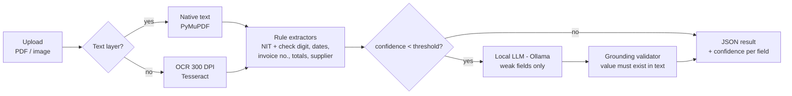

# Invoice AI Extractor

[](https://github.com/JohnDavidV/invoice-ai-extractor/actions/workflows/ci.yml)


-black)


A microservice that reads supplier invoices (native PDFs, scanned PDFs or photos) and returns structured data: the **issuer's tax ID (Colombian NIT)**, supplier name, invoice number, issue and due dates, and the total amount. Every field comes with a confidence score.

It uses a **rules-first, LLM-second** design. Deterministic extractors handle most documents. A *local* LLM (Ollama) is asked only about the fields the rules could not resolve, and its answers are **grounded**: a value is accepted only if it actually appears in the document. No data leaves the server, and no cloud API is required.

> This is a clean-room portfolio version of a document-intake service I designed, deployed and run in production, where it processes the incoming supplier correspondence of a company. The code, the data and the business rules here are written from scratch and use synthetic invoices only.

## Why this design

| Problem seen in production | How it is solved here |
|---|---|
| An invoice has several long numbers: phones, bank accounts, the **buyer's own NIT** | NIT candidates must pass the DIAN modulo-11 check digit. The buyer's NIT can be excluded per request. Two plausible issuers lower the confidence. |
| Many documents are scans with no text layer | PyMuPDF reads the native text. If it is too short, the pages are rendered at 300 DPI and passed to Tesseract (`spa+eng`). |
| LLMs make up numbers | The LLM sees only the weak fields. Every answer is validated against the source text, and NITs are re-checked with the check digit (see `app/llm.py`). |
| The server has no internet access | Everything runs locally: Tesseract plus Ollama. The LLM is optional, and the service still works with rules only. |
| Tesseract "works in the console but not as a Windows service" | The binary is resolved from an env var, then PATH, then the usual install folders (`app/reader.py`). |
| Rule changes cause regressions | `scripts/evaluate.py` measures accuracy per field on a labelled dataset. CI fails if accuracy drops below 95%. |

## Architecture



## Quick start

```bash
# 1. Local (needs tesseract-ocr installed)
pip install -r requirements-dev.txt
uvicorn app.main:app --reload --port 8500

# 2. Docker, with a local LLM
docker compose up -d
docker compose exec ollama ollama pull llama3.2:3b
```

```bash
python scripts/generate_samples.py --count 30 --out samples   # fictional invoices to play with
curl -F "file=@samples/invoice_001.pdf" -F "exclude_tax_ids=901555333-8" http://localhost:8500/extract
```

```json
{
  "readable": true,
  "text_source": "native",
  "tax_id":         { "value": "870511262-2", "confidence": 0.95, "source": "rules" },
  "supplier_name":  { "value": "Logistica Sabana S.A.S.", "confidence": 0.85, "source": "rules" },
  "invoice_number": { "value": "FE-48213", "confidence": 0.9, "source": "rules" },
  "issue_date":     { "value": "2026-04-11", "confidence": 0.9, "source": "rules" },
  "due_date":       { "value": "2026-05-11", "confidence": 0.9, "source": "rules" },
  "total_amount":   { "value": "3462900.00", "confidence": 0.9, "source": "rules" },
  "overall_confidence": 0.9
}
```

Interactive docs: `http://localhost:8500/docs`.

## Evaluation

```bash
python scripts/generate_samples.py --count 30 --out samples   # synthetic invoices, 3 layouts, ~30% scanned
python scripts/evaluate.py samples
```

```
field             accuracy
--------------------------
tax_id              100.0%
supplier_name       100.0%
invoice_number      100.0%
issue_date          100.0%
due_date            100.0%
total_amount        100.0%
--------------------------
overall             100.0%  (30 documents)
```

The synthetic set is deliberately clean. Real supplier documents are much messier, which is why the confidence scores and the LLM fallback exist. The evaluation script lets you plug in any labelled dataset (`ground_truth.json` plus files) and track progress.

## Configuration

| Variable | Default | Purpose |
|---|---|---|
| `EXTRACTOR_OLLAMA_URL` | *(empty)* | Ollama base URL. Leave it empty to use rules only. |
| `EXTRACTOR_OLLAMA_MODEL` | `llama3.2:3b` | Any local model that supports JSON output |
| `EXTRACTOR_MIN_CONFIDENCE` | `0.55` | Fields below this score are sent to the LLM |
| `EXTRACTOR_TESSERACT_CMD` | *(auto)* | Explicit Tesseract path (Windows services) |
| `EXTRACTOR_OCR_LANG` | `spa+eng` | Tesseract languages |
| `EXTRACTOR_MAX_UPLOAD_MB` | `15` | Upload size limit |

## Project layout

```
app/
  main.py       FastAPI endpoints (/health, /extract)
  reader.py     native text vs OCR
  rules.py      deterministic extractors + date/amount parsers (es-CO & en-US)
  nit.py        DIAN check-digit algorithm
  llm.py        Ollama client + grounding validator
  pipeline.py   orchestration and confidence scoring
scripts/
  generate_samples.py   fictional dataset with ground truth
  evaluate.py           accuracy per field, CI gate
tests/                  41 tests: parsers, NIT, grounding (LLM mocked), API
```

## Tests

```bash
pytest -q        # 41 passed
ruff check .
```

## License

MIT
